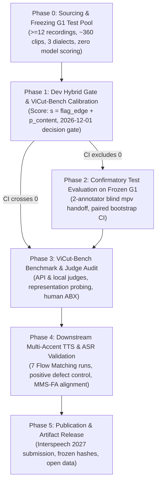

# Research & Engineering Plan: Multi-Dialect Vietnamese Audio Curation Pipeline

**Project Goal:** Build an automated curation gate that filters acoustic and boundary defects (word-edge clipping, background music bleed, secondary speaker crosstalk, noise) without discarding good speech, maximizing speaker and regional diversity (North / Central / South) to produce training data for high-accuracy Vietnamese ASR, Audio Understanding (SpeechLLM), and TTS models.

---

## Phase Structure & Execution Rules

This plan is structured into **strictly sequential phases**. Each phase begins **only after** all exit criteria of the preceding phase have been fully met, verified on disk, and committed to git.

---

## Phase 0: Sourcing & Freezing the Regionally Stratified G1 Test Pool (Prerequisite & Ground Truth Foundation)

**Objective:** Build a statistically powered, regionally balanced ground-truth test set that replaces the old unbalanced 3-recording pool and is formally frozen before any model evaluation.

### Tasks & Specifications
1. **Source Candidate Pool:**
   - Select $\ge 12$ untouched YouTube recordings strictly disjoint in channel IDs, video IDs, and speakers from `dev-288`, ViCut-Bench, and prior training splits.
   - Stratified regional coverage: $\ge 4$ Northern (Bắc), $\ge 4$ Central (Trung), and $\ge 4$ Southern (Nam) recordings.
   - Genre coverage: At least one studio interview and at least one music-backed vlog/broadcast.
   - Disjointness checks: Cross-check against all URLs in `.data/` and verify speaker embedding distances against `dev-288`.
2. **Audio Segmentation & Filtering:**
   - Slice audio strictly using the fixed `recipe_nolock` pipeline (no model or probe scoring).
   - Strict source cap: $\le 30$ clips per recording to yield $\approx 360$ clips total (guaranteeing $\ge 300$ valid clips even if clips are dropped).
   - Contamination remediation: Permanently drop and replace `g1_001.wav` (previously inspected).
3. **Packaging Blind Review Batches (GOAL §6 Compliance):**
   - Copy audio to `.data/goal/g1_blind_audio/<review_id>.wav` with opaque 8-character hex IDs.
   - Partition into $\approx 10$ batches of $\le 40$ clips / $\le 15$ min audio each under `.data/goal/review/g1_test/batch_XX/`.
   - Each batch directory contains **strictly three files**:
     * `REVIEW.md`: Review protocol and allowed `your_label` enum syntax (`pass`, `reject:end`, `reject:start`, `reject:spk`, `reject:music`, `reject:noise`, `reject:distort`, `unsure`).
     * `review.csv`: 7 columns (`review_id`, `abs_path`, `sha256`, `duration_s`, `listen_for`, `your_label`, `your_note`) with `your_label` shipping empty.
     * `playlist.m3u`: Absolute paths to batch WAV files.
   - Place mapping `key.jsonl` outside the review directories.
4. **Formal Hash Freeze:**
   - Compute SHA-256 for all clips and `test_manifest.jsonl`.
   - Append to `research/frozen_artifacts.sha256` and commit with `GOAL_CHANGE_APPROVED=1`.

### Exit Criteria
- [ ] $\ge 12$ recordings and $\ge 350$ valid clips sourced, balanced across North, Central, and South accents.
- [ ] `sha256sum --quiet -c research/frozen_artifacts.sha256` passes cleanly including all new G1 entries.
- [ ] All $\approx 10$ batch directories contain strictly `REVIEW.md`, `review.csv` (with empty `your_label`), and `playlist.m3u`.
- [ ] `STATUS.md` updated and committed.

---

## Phase 1: Real-Dev Hybrid Candidate Optimization & ViCut-Bench Calibration (G2 & G3)

**Objective:** Calibrate and evaluate a single, continuous, deterministic hybrid curation gate on `dev-288` and synthetic ViCut-Bench, resolving content probe saturation and word-edge blind spots.

### Tasks & Specifications
1. **Implement Single Candidate Decision Rule:**
   - **Pre-gate:** Deterministic digital silence / low-energy rejection at RMS $< -50\text{ dBFS}$ (eliminates hallucination).
   - **Boundary arm:** Deterministic 10 ms edge energy ratios (start and end). Thresholded at 95% specificity on held-out 5-fold OOF `clean_tight_tr` (tight twins). If start energy ratio $>$ start_thresh OR end energy ratio $>$ end_thresh, `flag_edge = 1.0`, else `0.0`.
   - **Content arm:** `phowhisper` (vinai/phowhisper-small) Layer 4 encoder representation with `mean_std` pooling for secondary speaker and background music heads. Trained on ViCut-Bench train defects vs clean anchors/tight twins negatives, calibrated via 5-fold OOF logistic regression to yield $p_{\text{sec}}$ and $p_{\text{music}}$, combined as $p_{\text{content}} = \max(p_{\text{sec}}, p_{\text{music}})$.
   - **Decision score & determinism:** Scalar score $s = \text{flag\_edge} + p_{\text{content}}$ with lexicographical ranking tuple `(pre_gate, flag_edge, p_content, review_id)`.
2. **Mechanism Validation on ViCut-Bench (G3):**
   - Confirm false reject rate on clean twins at 0 ms cuts remains $\le 3.3\%$.
   - Score detection AUROC across the 4 realized defect types (4,800 clips).
3. **Dev Benchmark Competition (dev-288, 11 recordings):**
   - Evaluate against all G2 baselines:
     * Discrete `flash_lite` and `gemini_38_flash` at native minute yield ($\pm 10\%$).
     * Continuous `signal_only` (3-feature composite) at standard 70.0% minute yield and full R-yield curves.
     * 100% all-pass `recipe_nolock` and `e2b_v3` at 90.0% minute yield.
   - Compute paired recording-bootstrap 95% CI (1,000 resamples, seeds 42 and 123) for candidate $R$ minus baseline $R$.
4. **Pre-registered Decision Gate (Deadline: 2026-12-01):**
   - **Branch A:** Candidate beats dev baselines with 95% CI strictly excluding 0 $\rightarrow$ Proceed to Phase 2.
   - **Branch B (Fallback):** CI crosses 0 by 2026-12-01 $\rightarrow$ Method iteration ceases immediately; lock candidate and proceed to Phase 3 (ViCut-Bench Benchmark & Probe/Judge Audit Paper).

### Exit Criteria
- [ ] Evaluation script `evaluate_hybrid_gate.py` runs deterministically with raw logs and seed control.
- [ ] Report committed to `.data/vicut_bench/reports/dev_hybrid_gate/` documenting R, yields, and bootstrap CIs.
- [ ] Clean-twin FRR verified $\le 3.3\%$.
- [ ] STATUS.md updated with confirmed dev findings.

---

## Phase 2: Confirmatory Test Evaluation on Frozen G1 (G1 & G2)

**Objective:** Conduct the one-shot confirmatory evaluation on the frozen G1 test set.

### Tasks & Specifications
1. **Blind Human Annotation:**
   - Two annotators independently review all batches in `mpv` using the 7-column schema.
   - Compute Cohen's $\kappa$ per dimension (`speaker_purity`, `word_completeness`, `audio_quality`).
2. **Disagreement & Defect Labeling:**
   - Ground truth defect label: Clip is bad if **either** annotator marks it bad (conservative union).
   - Secondary sensitivity analysis: Clip is bad only if **both** annotators agree (intersection).
   - Unsure handling: Counted as bad in primary analysis; excluded in sensitivity analysis.
3. **One-Shot Baseline Competition:**
   - Candidate threshold derived via label-free score quantile on G1 test to match each baseline's test yield ($\pm 10\%$).
   - Compute paired recording-bootstrap 95% CI (1,000 resamples by recording, seeds 42 and 123) across the $\ge 12$ recordings.

### Exit Criteria
- [ ] Completed blind review sheets from two annotators committed to `.data/goal/review/g1_test/completed/`.
- [ ] Inter-annotator Cohen's $\kappa$ documented per dimension.
- [ ] Final G1 test report committed to `.data/goal/reports/g1_test_evaluation/` confirming candidate beats baselines with 95% CI excluding 0.

---

## Phase 3: Multi-Modal Judge Audit & Representation Probing (ViCut-Bench)

**Objective:** Audit leading LLM/audio judges and probe speech representations against synthetic ground truth, self-contained without requiring human labels.

### Tasks & Specifications
1. **Multi-Modal Judge Audit:**
   - Benchmark Gemini 3.8 Flash (API), Antigravity Gemini 3.8 subagent (with energy pre-gate), Flash-Lite, and local Gemma 4 E2B on the 4,800 ViCut-Bench defect pool.
   - Document sensitivity curves, silence hallucinations, and word-boundary insensitivity across severities.
2. **Representation Probing Analysis:**
   - Document layer-wise probe performance across WavLM, PhoWhisper, and Gemma Audio.
   - Analyze the 40 ms (Gemma) vs 20 ms (PhoWhisper/WavLM) frame-rate bottleneck on word-edge truncation.
3. **Human Perceptual Threshold Calibration:**
   - Run the GRAND_PLAN §107 ABX listening protocol (20 pairs per defect $\times$ severity) across the 4 realized defect types to map human perceptual thresholds against model detection limits.

### Exit Criteria
- [ ] Phase 2 Judge Audit report committed to `.data/vicut_bench/reports/judge_audit/`.
- [ ] Probing and frame-rate bottleneck analysis committed with reproducible figures.
- [ ] Human perceptual threshold tables established for all 4 realized defect classes.

---

## Phase 4: Downstream Multi-Accent Speech Modeling & Defect Sensitivity (G4)

**Objective:** Prove downstream model sensitivity to data defects and demonstrate that hybrid curation yields superior Vietnamese ASR and TTS models.

### Tasks & Specifications
1. **Multi-Speaker Dataset Assembly:**
   - Assemble raw audio pool spanning Northern, Central, and Southern accents, capped at $\le 15$ min/speaker.
2. **Positive Control Experiment (7 Flow Matching TTS Runs):**
   - Train Flow Matching TTS recipe across 5 pre-registered defect conditions:
     1. Clean audio (seed 1 & seed 2)
     2. Clipped word end @ 30%
     3. Secondary speaker @ 30%
     4. Mixed defects @ 10%
     5. Mixed defects @ 30% (seed 1 & seed 2)
   - Verify that downstream phonetic CER and truncated ending rates are statistically sensitive to injected defect levels.
3. **Curator Comparison Experiment:**
   - Curate equal hours using: Candidate Gate vs Baseline Gates (`recipe_nolock`, `signal_only`, `flash_lite`).
   - Train Flow Matching TTS and PhoASR on equal-hours subsets cut via fixed random seed.
4. **Independent Evaluation:**
   - Automated word-ending truncation measured via independent MMS-FA CTC forced alignment (disjoint from WavLM / edge energy).
   - Phonetic CER/WER evaluated on held-out multi-dialect test sets.

### Exit Criteria
- [ ] Positive control confirms downstream defect sensitivity.
- [ ] G4 Downstream Report committed to `.data/downstream_experiments/G4_DOWNSTREAM_REPORT.md` confirming candidate-curated data achieves strictly lower CER and 0 truncated endings compared to uncurated/baseline data.

---

## Phase 5: Publication Packaging & Artifact Release (G5)

**Objective:** Package the findings, codebase, and datasets for paper submission (Interspeech 2027).

### Tasks & Specifications
1. **Paper Manuscript:** Write paper highlighting ViCut-Bench, representation probing, judge audits, and downstream multi-accent curation gains.
2. **Artifact Verification:** Verify all SHA-256 hashes in `research/frozen_artifacts.sha256`.
3. **Open Release:** Clean documentation, scripts, and checkpoint release.

### Exit Criteria
- [ ] Final manuscript compiled.
- [ ] All code, configs, and frozen hashes pass reproducibility verification.
