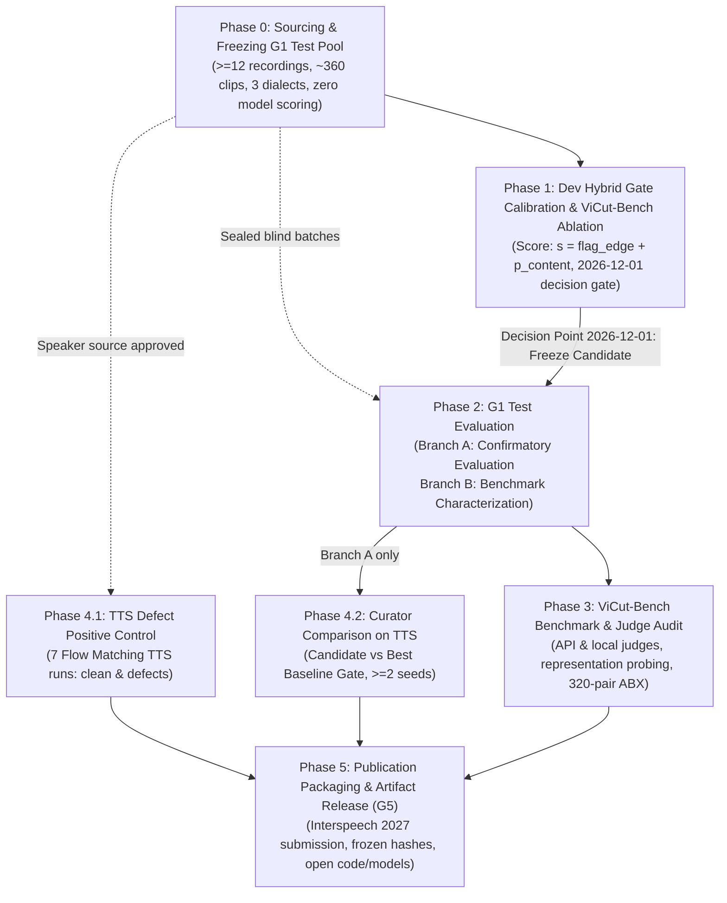

# Research & Engineering Plan: Multi-Dialect Vietnamese Audio Curation Pipeline

**Governance Hierarchy:** `GOAL.md` > `research/GRAND_PLAN.md` > `PLAN.md`. All criteria and constraints in `GOAL.md` are binding and take precedence.

**Binding Research Objective (`GOAL.md` §1 verbatim):**
> *"Build a curation method that rejects more defective clips without discarding more good speech. Show the gain on human-labelled clips from recordings never used during development, then show that the gain carries over to a TTS model trained on equal hours of the curated data."*

**User Application Scope:** To maximize real-world utility across Vietnamese speech modeling, data collection enforces balanced regional coverage across Northern (Bắc), Central (Trung), and Southern (Nam) dialects with channel deduplication.

---

## Phase Structure & Execution Rules

The pipeline is organized into **strictly sequential milestone gates** with parallelizable operational tracks. Human annotation of blind batches (Phase 2) runs in parallel with Phase 1 gate development because batches are sealed, opaque, and strictly isolated from model development. Similarly, Phase 4.1 TTS positive-control training starts once the speaker pool is approved (post-Phase 0), meeting the 2026-12-20 milestone.

---

## Phase 0: Sourcing & Freezing the Regionally Stratified G1 Test Pool (Prerequisite & Ground Truth Foundation)

**Objective:** Build a statistically powered, regionally balanced ground-truth test set ($\approx 360$ clips across $\ge 12$ recordings) that replaces the old unbalanced 3-recording pool and is formally frozen before any model evaluation.

### Tasks & Specifications
1. **Source Candidate Pool:**
   - Select $\ge 12$ untouched YouTube recordings strictly disjoint in channel IDs, video IDs, and speakers from `dev-288`, ViCut-Bench, and prior training splits.
   - Stratified regional coverage: $\ge 4$ Northern (Bắc), $\ge 4$ Central (Trung), and $\ge 4$ Southern (Nam) recordings.
   - Genre coverage: At least one studio interview and at least one music-backed vlog/broadcast.
   - Disjointness checks: Cross-check against all URLs/video IDs in `.data/` and verify speaker embedding cosine similarity $< 0.70$ (using Resemblyzer / PyAnnote speaker embeddings calibrated at EER threshold) against `dev-288`, ViCut-Bench, and downstream TTS speakers. (Embedding extraction for disjointness verification does not constitute model scoring).
   - Old pool retirement: Archive existing candidate pool (`.data/goal/test_manifest.jsonl`) to `.data/goal/test_manifest_archived_3rec.jsonl`.
2. **Audio Segmentation & Filtering:**
   - Slice fresh audio strictly using the fixed `recipe_nolock` pipeline (no model or probe scoring).
   - Cap each recording at $\le 30$ clips to yield $\approx 360$ clips total. If any recording yields fewer than 30 valid clips, additional recordings are added to guarantee $\ge 300$ valid clips.
   - Exclude the previous 3 recordings entirely (automatically eliminating contaminated `g1_001.wav`).
3. **Packaging Blind Review Batches (GOAL §6 Compliance):**
   - Copy audio to `.data/goal/g1_blind_audio/<review_id>.wav` with opaque 8-character hex IDs.
   - Partition into $\approx 10$ batches of $\le 40$ clips / $\le 15$ min audio each under `.data/goal/review/g1_test/batch_XX/`.
   - Each batch directory contains **strictly three files**:
     * `REVIEW.md`: Protocol, listening instructions, replay key bindings in `mpv`, estimated completion time, and allowed label syntax.
     * `review.csv`: 7 columns (`review_id`, `abs_path`, `sha256`, `duration_s`, `listen_for`, `your_label`, `your_note`) with `your_label` shipping empty. `listen_for` contains generic review instructions without leaking condition.
     * `playlist.m3u`: Absolute paths to batch WAV files.
   - **Labeling Rubric Syntax (`docs/experiments.md:25-28`):**
     * `your_label` requires either `pass` (all 3 dimensions clean), `unsure`, or the exact closed-vocabulary semicolon tag string covering all three dimensions:
       `spk=<pure|secondary_speaker|overlapping_speech>;word=<complete|clipped_word_start|clipped_word_end>;aq=<studio_clean|music_bleed|noisy_reverberant|distorted>`
     * No dimensions may be omitted. (Cohen's $\kappa$ drops `unsure` rows; secondary sensitivity analysis treats `unsure` as a separate category).
   - Place mapping `key.jsonl` outside the review directories (`.data/goal/g1_blind_audio/key.jsonl`).
4. **Formal Hash Freeze:**
   - Compute SHA-256 for all clips and `test_manifest.jsonl`.
   - Append to `research/frozen_artifacts.sha256`. The user sets `GOAL_CHANGE_APPROVED=1` in a user-approved commit (the agent never sets this flag).

### Exit Criteria
- [ ] $\ge 12$ recordings and $\ge 300$ valid clips sourced, verified disjoint, and balanced across North, Central, and South accents.
- [ ] `sha256sum --quiet -c research/frozen_artifacts.sha256` passes cleanly including all new G1 entries.
- [ ] All $\approx 10$ batch directories contain strictly `REVIEW.md`, `review.csv` (with empty `your_label`), and `playlist.m3u`.
- [ ] `key.jsonl` verified outside review directory.
- [ ] `research/STATUS.md` updated and committed.

---

## Phase 1: Real-Dev Hybrid Candidate Optimization & ViCut-Bench Calibration (G2 & G3)

**Objective:** Calibrate and evaluate a single, continuous, deterministic hybrid curation gate on `dev-288` and synthetic ViCut-Bench, resolving content probe saturation and word-edge blind spots.

### Tasks & Specifications
1. **Implement Single Candidate Decision Rule:**
   - **Pre-gate:** Deterministic digital silence / low-energy rejection at RMS $< -50\text{ dBFS}$ (eliminates silence hallucination).
   - **Boundary arm:** Deterministic 10 ms edge energy ratios (start and end). Thresholded at 95% specificity on held-out 5-fold OOF `clean_tight_tr` (tight twins). If start energy ratio $>$ start_thresh OR end energy ratio $>$ end_thresh, `flag_edge = 1.0`, else `0.0`.
   - **Content arm:** `phowhisper` (vinai/phowhisper-small) Layer 4 encoder representation with `mean_std` pooling for secondary speaker and background music heads. Trained on ViCut-Bench train defects vs clean anchors/tight twins negatives, calibrated via 5-fold OOF logistic regression to yield $p_{\text{sec}}$ and $p_{\text{music}}$, combined as $p_{\text{content}} = \max(p_{\text{sec}}, p_{\text{music}})$.
   - **Decision score & determinism:** Scalar score $s = \text{flag\_edge} + p_{\text{content}}$ with lexicographical ranking tuple `(pre_gate, flag_edge, p_content, clip_id)`: pre-gate rejects rejected first, followed by edge-flagged clips ($s \in [1.0, 2.0]$) ranked by $p_{\text{content}}$, followed by unflagged clips ($s \in [0.0, 1.0]$) ranked by $p_{\text{content}}$, with exact ties broken by alphabetical `clip_id`.
2. **ViCut-Bench G3 Mechanism & Ablation:**
   - Compute detection AUROC and per-severity detection curves across the 4 realized defect types strictly on the **held-out test split (90 anchors / 19 speakers)** or 5-fold OOF predictions (zero train-split leakage).
   - Measure and report clean-twin false reject rate (FRR) on held-out tight twins at 0 ms cuts.
   - Run required G3 component ablation on real `dev-288`:
     * Full Hybrid Gate ($R$ at matched 70% yield)
     * Content arm only (ranked by continuous $p_{\text{content}}$, $R$ at 70% yield)
     * Boundary arm only (ranked by continuous normalized edge ratio $\max(r_{\text{start}}/\tau_{\text{start}}, r_{\text{end}}/\tau_{\text{end}})$, $R$ at 70% yield)
     * Full Gate without Pre-gate (leave-one-out, $R$ at 70% yield)
     * Pre-gate only (reported at native yield)
3. **Dev Benchmark Competition (dev-288, 11 recordings):**
   - Candidate evaluated against each non-circular dev baseline:
     * Discrete `flash_lite` at its native minute yield ($\pm 10\%$).
     * Continuous `signal_only` (3-feature composite) at standard 70.0% minute yield and full R-yield curves.
     * 100% all-pass `recipe_nolock` and `e2b_v3` at 90.0% minute yield.
     *(Note: `gemini_38_flash` is excluded from dev competition because dev-288 labels were generated by Gemini 3.8 Flash, making agreement circular; it competes on human-labeled G1).*
   - Compute paired recording-bootstrap 95% CI (1,000 resamples, seeds 42 and 123) for candidate $R$ minus baseline $R$.
4. **Pre-registered Decision Gate (Deadline: 2026-12-01):**
   - **Branch A:** Candidate beats each dev baseline with 95% CI strictly excluding 0 across both seeds $\rightarrow$ Freeze candidate rule weights, config, and SHA-256 hash in `WORKLOG.md` and proceed to Phase 2 confirmatory test evaluation.
   - **Branch B (Fallback):** CI crosses 0 by 2026-12-01 $\rightarrow$ Halt method iteration immediately; lock candidate, log honest null dev findings in `WORKLOG.md`, and proceed to Phase 2 (G1 Test Set Benchmark Characterization) and Phase 3 (ViCut-Bench Benchmark & Probe/Judge Audit Paper). Curator comparison in Phase 4.2 is skipped.

### Exit Criteria
- [ ] Evaluation script `scripts/vicut_bench/evaluate_hybrid_gate.py` (with bash launcher `scripts/vicut_bench/evaluate_hybrid_gate.sh`) runs deterministically with raw logs and documented commands in `docs/commands.md`.
- [ ] Held-out AUROC and per-severity detection curves computed and documented.
- [ ] Report written to `.data/vicut_bench/reports/dev_hybrid_gate/` documenting R, yields, bootstrap CIs, and G3 real-data ablation table, with file paths and SHA-256 hashes logged in `WORKLOG.md`.
- [ ] Clean-twin FRR reported on held-out tight twins.
- [ ] Candidate frozen hash committed to `WORKLOG.md` before Phase 2.
- [ ] `STATUS.md` updated with confirmed dev findings.

---

## Phase 2: G1 Test Evaluation (Confirmatory / Benchmark Characterization)

**Objective:** Conduct the one-shot evaluation on the frozen G1 test set (Confirmatory test for Branch A; Benchmark Characterization for Branch B).

### Tasks & Specifications
1. **Blind Human Annotation:**
   - Two annotators independently review all batches in `mpv` using the agreed labeling schema.
   - Read-back protocol (GOAL §6): Join by `review_id`, recompute audio hashes and drop mismatched rows, never fill empty labels, save `review_labelled.csv` and log SHA-256 in `WORKLOG.md`.
   - Compute Cohen's $\kappa$ per dimension (`speaker_purity`, `word_completeness`, `audio_quality`) dropping `unsure` rows.
2. **Disagreement & Defect Labeling:**
   - Ground truth defect label: Clip is bad if **either** annotator marks it bad (conservative union).
   - Secondary sensitivity analysis: Clip is bad only if **both** annotators agree (intersection).
   - Unsure handling: Counted as bad in primary analysis; excluded in sensitivity analysis.
3. **One-Shot Baseline Competition:**
   - Baseline inference: Run fixed baselines (`signal_only`, `flash_lite`, `gemini_38_flash`, `e2b_v3`, `recipe_nolock`). API calls trickled with `--continue` to respect free-tier rate limits.
   - Verify candidate SHA-256 and frozen G1 hashes (`sha256sum -c`) before test execution.
   - Candidate threshold derived via label-free score quantile on G1 test to match each baseline's exact native yield (with $\pm 10\%$ tolerance band; 100% baselines matched at 90% and `signal_only` matched at 70%).
   - Compute paired recording-bootstrap 95% CI (1,000 resamples by recording, seeds 42 and 123) across the $\ge 12$ recordings. Full R-yield curves plotted.
4. **Reporting:**
   - Log results honestly regardless of outcome (confirming improvement under Branch A or documenting real-world test gap under Branch B per GOAL §2.7).

### Exit Criteria
- [ ] Completed blind review sheets from two annotators saved under `.data/goal/review/g1_test/completed/` with SHA-256 hashes recorded in `WORKLOG.md`.
- [ ] Inter-annotator Cohen's $\kappa$ documented per dimension.
- [ ] Final G1 test report written to `.data/goal/reports/g1_test_evaluation/` with paths/hashes in `WORKLOG.md` and findings summarized under STATUS "Test-set evaluations".

---

## Phase 3: Multi-Modal Judge Audit & Representation Probing (ViCut-Bench)

**Objective:** Audit leading LLM/audio judges and probe speech representations against synthetic ground truth.

### Tasks & Specifications
1. **Multi-Modal Judge Audit:**
   - Benchmark Gemini 3.8 Flash (API, on pre-declared stratified subset), Antigravity Gemini 3.8 subagent (with energy pre-gate), Flash-Lite, and local Gemma 4 E2B on ViCut-Bench.
   - Measure clean-clip false reject rate (H1), 50% detection threshold across severities, and paired clean/defect consistency (H2).
   - Compare Gemma probe vs Gemma generative zero-shot verdict on identical encoder features (GRAND_PLAN C3).
   - Document silence hallucinations and boundary insensitivity across severities.
2. **Representation Probing Synthesis:**
   - Synthesize findings from layer-wise probe experiments across WavLM, PhoWhisper, and Gemma Audio (citing `.data/vicut_bench/reports/phase3_probes/PHASE3_PROBE_REPORT.md`).
   - Document the 40 ms (Gemma) vs 20 ms (PhoWhisper/WavLM) frame-rate bottleneck on word-edge truncation.
3. **Human Perceptual Threshold Calibration:**
   - Run the ABX listening protocol (2 listeners, 20 pairs per defect $\times$ severity = 320 stimuli, packaged in 8 blind $\le 40$-stimulus batches without revealing twin identities) across the 4 realized defect types (clipped word start, clipped word end, secondary speaker, background music) to map human perceptual thresholds against model detection limits.

### Exit Criteria
- [ ] Judge Audit report written to `.data/vicut_bench/reports/judge_audit/` with hashes logged in `WORKLOG.md`.
- [ ] Probing and frame-rate bottleneck analysis compiled with reproducible figures.
- [ ] Human perceptual threshold tables established for all 4 realized defect classes.

---

## Phase 4: Downstream Speech Modeling & Defect Sensitivity (G4)

**Objective:** Demonstrate downstream TTS model sensitivity to data defects and evaluate curation impact on Vietnamese TTS synthesis.

### Tasks & Specifications
1. **Phase 4.1: Positive Control Experiment (7 Flow Matching TTS Runs):**
   - Speaker pool sourced with user approval under STATUS open decisions (can run in parallel with Phase 1–3 once approved).
   - Train Flow Matching TTS recipe across 5 pre-registered defect conditions (fixed text and training steps):
     1. Clean audio (seed 1 & seed 2)
     2. Clipped word end @ 30%
     3. Secondary speaker @ 30%
     4. Mixed defects @ 10%
     5. Mixed defects @ 30% (seed 1 & seed 2)
   - Verify whether downstream CER and truncated ending rates are statistically sensitive to injected defect levels via paired bootstrap across 200 held-out sentences.
2. **Phase 4.2: Curator Comparison Experiment (Branch A only):**
   - Pre-declared best baseline rule: the baseline with the **smallest candidate-minus-baseline $R$ reduction at that baseline's own matched yield** from Phase 2 (i.e. the hardest baseline to beat); ties broken by higher accepted-minute yield.
   - Curate equal hours using: Candidate Gate vs Best Baseline Gate (same speaker pool, text, and training steps).
   - Train Flow Matching TTS ($\ge 2$ seeds per curator) on equal-hours subsets cut via fixed random seed. (Skipped under Branch B).
3. **Independent Evaluation (GOAL G4 Metrics):**
   - Automated word-ending truncation measured via independent MMS-FA CTC forced alignment and energy drop on 200 held-out sentences.
   - CER evaluated with PhoASR-whisper-small on 200 held-out sentences.
   - Blind listening test on held-out synthesized sentences.

### Exit Criteria
- [ ] Positive control sensitivity analysis documented (establishing defect impact or tolerance thresholds).
- [ ] G4 Downstream Report written to `.data/downstream_experiments/G4_DOWNSTREAM_REPORT.md` documenting CER, truncated ending rates, and listening test results (reporting gains or honest bounds). Paths and hashes logged in `WORKLOG.md`.

---

## Phase 5: Publication Packaging & Artifact Release (G5)

**Objective:** Package findings, codebase, and reproducible assets for paper submission (Interspeech 2027).

### Tasks & Specifications
1. **Paper Manuscript:** Compile manuscript highlighting ViCut-Bench, representation probing, judge audits, and curation experiments.
2. **Artifact Verification:** Verify all SHA-256 hashes in `research/frozen_artifacts.sha256`.
3. **Open Release:** Release open source code, manifests, probe heads, gate weights, and model checkpoints where licensing permits (no proprietary or copyrighted raw audio released).

### Exit Criteria
- [ ] Final manuscript compiled.
- [ ] All code, manifests, and frozen hashes pass reproducibility check.
