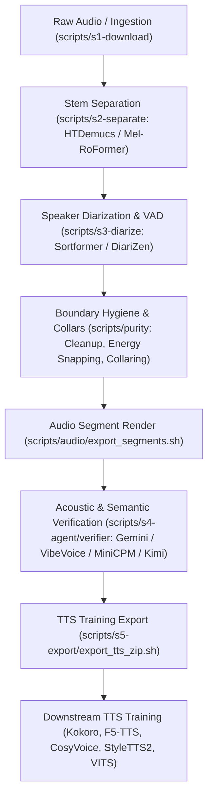

# TTS model training and evaluation guide

[← Overview](README.md) · [CLI Cookbook](commands.md) · [Data Contract](data_contract.md) · [Agent Verifier](agent_verifier.md)

This guide documents the end-to-end process of preparing speech datasets, training downstream Text-to-Speech (TTS) / voice cloning models, distilling local verifier models, and benchmarking performance against current state-of-the-art (SOTA) standards with specific focus on **Vietnamese speech characteristics**.

---

## 1. End-to-End Pipeline Architecture

The pipeline takes unconstrained, in-the-wild multi-speaker audio (e.g. YouTube recordings, podcasts, talk shows) and refines it into zero-contamination speech datasets suitable for acoustic tokenizer and TTS training.



### Operational Steps

1. **Ingest Audio**:
   ```bash
   bash scripts/s1-download/youtube.sh --url '<YOUTUBE_URL>' --output-dir .data/s1-download/source
   ```
2. **Isolate Vocal Stems** (eliminate background music bleed and sound effects):
   ```bash
   bash scripts/s2-separate/htdemucs_ft.sh --input-dir .data/s1-download/source --output-dir .data/s2-separate/source
   ```
3. **Diarize Speakers & Segment Turns**:
   ```bash
   bash scripts/s3-diarize/sortformer.sh --input-dir .data/s2-separate/source --output-dir .data/s3-diarize/source
   ```
4. **Boundary Hygiene & Duration Slicing**:
   ```bash
   bash scripts/purity/cleanup.sh --input-manifest .data/s3-diarize/source/<stem>/segments.json --output-manifest .data/purity/cleaned.json
   bash scripts/purity/collar.sh --input-manifest .data/purity/cleaned.json --output-manifest .data/purity/collared.json
   bash scripts/audio/export_segments.sh --input-manifest .data/purity/collared.json --output-dir .data/clips/source
   ```
5. **Quality & Purity Verification**:
   - Cloud Reference (offline gold standard):
     ```bash
     bash scripts/s4-agent/verifier/gemini.sh --input-dir .data/clips/source --model gemini-3.8-flash --reasoning-effort medium
     ```
   - Local Offline (Zero-API-key, AMD ROCm):
     ```bash
     bash scripts/s4-agent/verifier/vibevoice.sh --input-dir .data/clips/source
     ```
6. **Export Training Package**:
   ```bash
   bash scripts/s5-export/export_tts_zip.sh \
     --input-dir .data/s4-agent/verifier/gemini/gemini-3-8-flash/medium \
     --input-manifest .data/clips/source/segments.json \
     --output-file .data/s5-export/tts_dataset.zip
   ```

---

## 2. TTS Training Package Contract

Unzipping `tts_dataset.zip` yields a clean structure without enclosing parent directories:

```text
audio/
  clip_0001.wav
  clip_0002.wav
spoken.csv
written.csv
```

### Transcript Dual-Representation
- **`spoken.csv` (`audio_path,transcript`)**:
  Replaces foreign and annotated tokens with normalized spoken phonemic expansions (`word[ViePhoneme]` or `word[/IPA/]`), keeps emotion labels (`[happy]`, `[sad]`), non-verbal markers (`<laugh>`, `<sigh>`), and pause markers (`~`, `*`). The `[neutral]` tag is stripped.
- **`written.csv` (`audio_path,transcript`)**:
  Preserves canonical orthography (e.g. keeping `AI`, `hello`, `9:15`) while stripping inline phonemic bracket annotations.

Example:
```text
Original Annotation: [neutral] Tôi dùng AI[ây_ai], [happy] hello[/həˈləʊ/]! <laugh>
Spoken Form:         Tôi dùng ây_ai, [happy] /həˈləʊ/! <laugh>
Written Form:        Tôi dùng AI, [happy] hello! <laugh>
```

---

## 3. State-of-the-Art (SOTA) TTS Evaluation Frameworks

Modern TTS evaluation has progressed past subjective-only Mean Opinion Scores (MOS) and raw Word Error Rate (WER) toward standardized multi-dimensional benchmarks.

### SOTA Evaluation Matrix

| Evaluation Pillar | SOTA Metric & Tool | Underlying Mechanism | Target Benchmark |
|---|---|---|---|
| **Intelligibility & Robustness** | **Normalized WER / CER** (Whisper, PhoASR) | Automatic speech recognition over standardized test sets | WER < 5–8%, CER < 2–4% |
| **Speaker Similarity (Zero-shot)** | **SECS** (Speaker Encoder Cosine Similarity) | Pretrained **WavLM-TDNN**, **CAM++**, or **WeSpeaker ResNet34** | SECS $\ge 0.75$–$0.85$ |
| **Acoustic Quality** | **TTSDS / TTSDS2** & **UTMOS** | Distributional acoustic distance + SSL neural MOS predictor | UTMOS $\ge 3.8$–$4.2$ |
| **Expressiveness & Prosody** | **LALM-as-a-Judge** (Audio-LLM) | Large Audio Language Models evaluating prosody & emotion | Preference Elo rating |
| **Streaming Latency** | **TTFB / TTFA** (Time to First Byte/Audio) | Chunked streaming generation benchmark | Sub-150ms TTFB |

---

## 4. Vietnamese-Specific SOTA Benchmarks & Challenges

Evaluating Vietnamese speech models requires specialized handling of tone contours, checked syllable codas, and regional dialects.

### Leading Vietnamese TTS Benchmarks
1. **PhoAudiobook (ACL 2025)**:
   - **941 hours** across 735 narrators.
   - Gold-standard reference benchmark for Vietnamese zero-shot TTS, voice cloning, and long-form storytelling.
2. **VieNeu-TTS-140h**:
   - 140 hours with fine-grained International Phonetic Alphabet (IPA) and phonemic annotations.
3. **ViMD (Vietnamese Multi-Dialect Corpus)**:
   - Benchmark corpus evaluating accent transfer and preservation across **Northern (Bắc)**, **Central (Trung)**, and **Southern (Nam)** dialects.
4. **VLSP Evaluation Challenges (2020–2025)**:
   - Community-standard challenge sets assessing spontaneous synthesis, tone contour preservation, and voice conversion.

### Critical Vietnamese Linguistic Evaluation Metrics
* **Tone Error Rate (TER)**:
  Measures preservation of 6 linguistic tones (Ngang, Huyền, Sắc, Hỏi, Ngã, Nặng) in Northern dialects or 5 tones in Southern/Central dialects.
* **Glottal Stop & Coda Articulation**:
  Evaluates whether unreleased stops (`-p`, `-t`, `-c`, `-ch`) and glottalized tones (`hỏi`, `ngã`, `nặng`) are clearly produced without vocoder clipping.
* **$F_0$ Pitch Contour Correlation**:
  Cosine or Pearson correlation between extracted fundamental frequency ($F_0$) curves of synthesized audio and target references. Target: $r > 0.82$.

---

## 5. Vietnamese ASR Landscape: SOTA Alternatives to PhoWhisper

For automated ASR evaluation (WER/CER testing), several architectures surpass the initial `PhoWhisper` baseline:

| Model | Parameters | Vietnamese WER | Inference Speed | Audio Events / Emotion | Timestamps | Best Role |
|---|---|:---:|:---:|:---:|:---:|---|
| **PhoWhisper-small** (VinAI, ICLR 2024) | 244M | ~11.1% | Moderate | ❌ | Fair (whisperts) | Legacy baseline |
| **PhoASR-whisper-small** (Qualcomm, EACL 2026) | 244M | **~8.2%** | Moderate | ❌ | **Accurate** (native word tokens) | **Best drop-in replacement for WER & boundary checking** |
| **SenseVoice-Small** (Alibaba FunASR) | 230M | ~12.5% | **5x–15x Faster** | **Yes** (laughter, applause, emotion) | CTC frames | **Best for high-speed batch defect screening** |
| **Whisper-Large-v3-Turbo** (OpenAI) | 809M | ~9.5% | Fast | ❌ | Good | **Best for mixed English-Vietnamese code-switching** |

---

## 6. Offline / Local Verifier Execution on Local Hardware

To verify audio clips without consuming external API tokens or configuring cloud credentials (`GEMINI_API_KEY`):

### Supported Local Backends
The machine is equipped with an **AMD Radeon RX 9060 XT** (ROCm), with dedicated environments under `.venvs/`:
- **VibeVoice**: [`scripts/s4-agent/verifier/vibevoice.sh`](../scripts/s4-agent/verifier/vibevoice.sh) (supports `fp16`, `int8`, `nf4`).
- **MiniCPM-O**: [`scripts/s4-agent/verifier/minicpm.sh`](../scripts/s4-agent/verifier/minicpm.sh)
- **Kimi Audio**: [`scripts/s4-agent/verifier/kimi.sh`](../scripts/s4-agent/verifier/kimi.sh)
- **HuggingFace / Unsloth**: [`scripts/s4-agent/verifier/hf.sh`](../scripts/s4-agent/verifier/hf.sh), [`scripts/s4-agent/verifier/unsloth.sh`](../scripts/s4-agent/verifier/unsloth.sh)

### Running a Local Verification Test
```bash
bash scripts/s4-agent/verifier/vibevoice.sh \
  --input-file .data/tts_strategy/gold_benchmark_20260908/audio/lfIbjICmfW0_ff70a78d5f7c.wav \
  --output-dir .data/local_verify_test
```

### Distilling a Local Student Verifier
To train a lightweight local student verifier against the Gemini reference teacher:
```bash
# 1. Scaffold experiment workspace:
bash scripts/s4-agent/verifier/scaffold_experiment.sh -n gemma4_verifier_run1

# 2. Evaluate candidate student model against teacher reference verdicts:
bash scripts/s4-agent/verifier/evaluate_verifier.sh \
  --predictions-dir .data/s4-agent/verifier/experiments/gemma4_verifier_run1/predictions \
  --reference-dir .data/s4-agent/verifier/gemini/gemini-3-8-flash/medium \
  --output-file .data/s4-agent/verifier/experiments/gemma4_verifier_run1/eval_report.json
```
Governing rule: The error acceptance rate $R = \frac{\text{bad accepted clips}}{\text{accepted clips}}$ must be strictly below **5%**.
