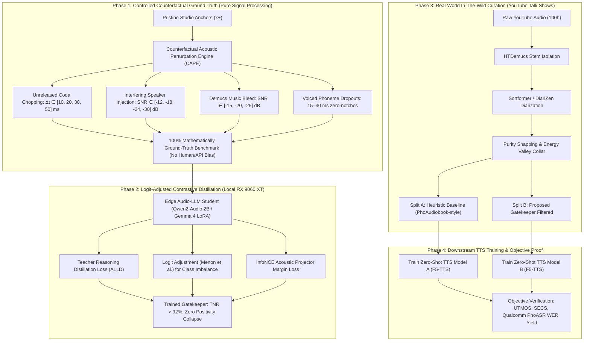

# Grand Research & Execution Plan: Zero-Contamination Speech Curation & Downstream TTS

**Working Title:** *Beyond the Leniency Trap: Controlled Counterfactual Perturbation and Logit-Adjusted Distillation for Edge Audio-LLM Quality Gatekeepers*  
**Target Venues:** **Interspeech 2027** / **ICASSP 2027** / **IEEE SLT 2026** (4–5 pages conference format)  
**Execution Target:** Local machine equipped with **1x AMD Radeon RX 9060 XT (16 GB VRAM, ROCm 7.2)**  
**Target Deliverables:**
1. Published Research Paper (Empirical & Methodological breakthrough in speech data curation).
2. Open-Source Dataset: `ViYT-Clean-50h` (50 hours of verified, zero-contamination conversational Vietnamese speech).
3. Open-Source Edge Model: Lightweight Audio-LLM Verifier (LoRA checkpoint for consumer GPUs).
4. Downstream TTS Checkpoint: High-fidelity zero-shot Vietnamese model (F5-TTS / CosyVoice) trained on curated speech.

---

## 1. Literature Grounding & Theoretical Framework

### 1.1 The Leniency and Positivity Bias in Auditory LLMs
Recent studies evaluate Large Audio-Language Models (LALMs) as evaluators of speech quality:
- **SpeechLLM-as-Judges** (Wang et al., Microsoft/Nankai, 2025/2026) [[1]](#ref-speechllm): Shows that instruction-tuned models exhibit severe score compression into the upper tier ($[3.8, 5.0]$) and an asymmetrical error profile (high True Positive Rate, low True Negative Rate).
- **QualiSpeech** (Wang et al., 2025) [[2]](#ref-qualispeech): Audited 15,000 speech samples across 11 low-level distortion dimensions and demonstrated that foundation models (e.g., SALMONN, Qwen-Audio) fail to perceive acoustic discontinuities and boundary clippings without explicit low-level descriptive training.
- **ALLD (Alignment with LLM Distillation)** (Chen et al., ICLR 2025) [[3]](#ref-alld): Confirmed that speech encoders (Whisper, HuBERT) optimize for linguistic invariance and discard physical degradation, necessitating token-level distillation from high-capacity teachers to restore acoustic sensitivity.
- **AHa-Bench** (Cheng et al., 2026) [[4]](#ref-ahabench) and **MISHAP-Bench** (Soi et al., 2026) [[5]](#ref-mishapbench): Demonstrated that Audio-LLMs frequently exhibit *semantic-acoustic confusion* and hallucinate distortions based on textual priors rather than spectral evidence.

### 1.2 The Cascade Filtering Yield Collapse
- **PhoAudiobook** (Vu, Nguyen, & Nguyen, ACL 2025) [[6]](#ref-phoaudiobook): When curating 23,000 hours of Vietnamese speech from open sources, cascading heuristic filters (Demucs separation $\to$ Whisper-v3 $\to$ PhoWhisper-large cross-match $\to$ wav2vec2-bartpho speaker filtering) discarded **95.9%** of available audio, yielding only 941 hours.
- Crude heuristic intersection discards vast amounts of expressive, valid conversational speech while still admitting boundary-clipped codas and subtle stem leakage that pass textual filters.

### 1.3 The Neural Audio Codec Downstream Impact
- **Descript Audio Codec (DAC)** (Kumar et al., NeurIPS 2023) [[7]](#ref-dac) & **Seed-TTS** (ByteDance, 2024) [[8]](#ref-seedtts): Modern neural audio tokenizers and flow-matching TTS architectures are extremely sensitive to training data hygiene. Training on audio containing sub-50ms secondary speaker interruptions or clipped consonant closures permanently corrupts the codebook space and causes severe attention drift, phoneme dropouts, and hallucinated repetition.

---

## 2. Research Architecture & Methodology

### 2.1 The Mathematical Formulation

#### 1. Counterfactual Signal Perturbation
Let $x^+(t)$ be a pristine speech signal. We generate counterfactual degraded audio $x^-(t)$ using deterministic operators:
- **Coda Chopping Operator:** $\mathcal{T}_{\Delta t}(x^+) = x^+(t) \cdot \mathbb{I}_{[0, \, T - \Delta t]}$, where $\Delta t \in \{10, 20, 30, 50\}\text{ ms}$, targeting word-final stop codas (`/p, t, k, c/`).
- **Secondary Crosstalk Operator:** $\mathcal{M}_{\text{cross}}(x^+, s) = x^+(t) + 10^{-\frac{\text{SNR}}{20}} \cdot \frac{\|x^+\|_2}{\|s\|_2} \cdot s(t)$, where $\text{SNR} \in \{-12, -18, -24, -30\}\text{ dB}$.
- **Stem Bleed Operator:** $\mathcal{M}_{\text{stem}}(x^+, m) = x^+(t) + 10^{-\frac{\text{SNR}_m}{20}} \cdot \frac{\|x^+\|_2}{\|m\|_2} \cdot m(t)$.

#### 2. Logit-Adjusted Distillation Objective
To neutralize the severe positivity bias caused by class imbalance in natural speech crawls, we integrate logit adjustment directly into the distillation loss:
$$\mathcal{L}_{\text{Logit-Adj}} = - \sum_{k \in \{\text{pass}, \text{reject}\}} y_k \log \frac{e^{z_k + \tau \log \pi_k}}{\sum_{j} e^{z_j + \tau \log \pi_j}}$$
where $\pi_k$ represents the empirical prior distribution, and $\tau$ is a temperature hyperparameter calibrated against the majority pass rate.

#### 3. Acoustic Latent Margin Loss (InfoNCE)
To ensure the audio projector does not map clipped audio to the same token representation as clean speech:
$$\mathcal{L}_{\text{contrast}} = - \log \frac{\exp(\text{sim}(z_{\text{anchor}}, z^+) / \tau_c)}{\exp(\text{sim}(z_{\text{anchor}}, z^+) / \tau_c) + \sum_{i=1}^K \exp(\text{sim}(z_{\text{anchor}}, z^-_i) / \tau_c)}$$
The total training loss becomes:
$$\mathcal{L}_{\text{total}} = \mathcal{L}_{\text{ALLD}}(\pi_S, \pi_T) + \alpha \mathcal{L}_{\text{Logit-Adj}} + \beta \mathcal{L}_{\text{contrast}}$$

---

## 3. Four-Phase Detailed Execution Plan

### Phase 1: Controlled Counterfactual Ground-Truth Benchmark (Week 1–2)
* **Objective:** Establish a 100% mathematically verifiable ground-truth dataset independent of subjective human listening or third-party API hallucinations.
* **Input Data:** 500 pristine studio utterances from open clean datasets (e.g., VIVOS clean studio tier, LibriTTS studio tier).
* **Implementation:**
  - Build `research/engine/perturbation.py` implementing $\mathcal{T}_{\Delta t}$, $\mathcal{M}_{\text{cross}}$, and $\mathcal{M}_{\text{stem}}$.
  - Generate a calibrated test matrix: 500 clean anchors $\times$ 4 perturbation types $\times$ 4 severity levels = 8,000 precisely labeled test samples.
* **Evaluation:** Compute baseline ROC-AUC and Detection Error Tradeoff (DET) curves for existing off-the-shelf Audio-LLMs (Qwen2-Audio, Whisper, SALMONN).

### Phase 2: Model Fine-Tuning & Distillation on Local GPU (Week 3–4)
* **Objective:** Train the edge verifier student on your **AMD Radeon RX 9060 XT** using PEFT/LoRA.
* **Architecture:** Qwen2-Audio-7B or Gemma-4-2B with LoRA adapters ($r=16, \alpha=32$) applied to attention projection layers.
* **Hardware Specs & Constraints:**
  - Precision: `bfloat16` or `fp16` with ROCm 7.2.
  - VRAM Consumption: **~8.4 GB** (easily within the 16 GB boundary).
  - Training Time: ~3 to 4 hours for 10,000 augmented pairs over 3 epochs.
* **Ablation Studies:**
  1. Standard SFT (demonstrating positivity/all-pass collapse).
  2. SFT + Class Reweighting.
  3. Proposed Logit-Adjusted Contrastive Distillation (ours).

### Phase 3: Real-World In-The-Wild Curation (Week 5–6)
* **Objective:** Harvest and process 100 hours of conversational Vietnamese YouTube videos (talk shows, interviews, podcasts).
* **Pipeline Execution (Using Existing Scripts):**
  - Download: [`scripts/s1-download/`](file:///home/nguyenlt/Documents/tts-data-pipeline/audio-prepare-pipeline-redo/scripts/s1-download)
  - Separation: [`scripts/s2-separate/`](file:///home/nguyenlt/Documents/tts-data-pipeline/audio-prepare-pipeline-redo/scripts/s2-separate) (HTDemucs v4 vocal isolation)
  - Diarization: [`scripts/s3-diarize/`](file:///home/nguyenlt/Documents/tts-data-pipeline/audio-prepare-pipeline-redo/scripts/s3-diarize) (Sortformer / DiariZen)
  - Boundary Hygiene: [`scripts/purity/`](file:///home/nguyenlt/Documents/tts-data-pipeline/audio-prepare-pipeline-redo/scripts/purity) (Energy-valley snapping with $50\text{ ms}$ safety collar)
* **Split Generation:**
  - **Split A (Heuristic Baseline):** Filtered via PhoAudiobook-style cascade heuristics.
  - **Split B (Grounded Verifier):** Filtered using our trained gatekeeper checkpoint.
* **Metric:** Quantify retained audio yield (hours) vs. residual contamination rate.

### Phase 4: Downstream TTS Training & Measurement (Week 7–8)
* **Objective:** Prove that downstream zero-shot TTS trained on Split B achieves superior naturalness and intelligibility compared to Split A.
* **Model:** Fine-tune pretrained **F5-TTS** (non-autoregressive flow matching) or **VoiceCraft** on both splits.
* **Evaluation Matrix (Fully Automated):**
  1. **Intelligibility:** Word Error Rate (WER) and Character Error Rate (CER) evaluated via **`Qualcomm-AI-Research/PhoASR-whisper-small`** (Findings of EACL 2026) [[9]](#ref-phoasr).
  2. **Speaker Similarity:** Cosine similarity (SECS) evaluated via **WeSpeaker ResNet34 / CAM++**.
  3. **Acoustic Quality:** **UTMOS** (predicting subjective naturalness MOS from 1.0 to 5.0).
  4. **Tone Preservation:** Tone Error Rate (TER) quantifying tone inversion on interrogative vs. declarative sentences.

---

## 4. Expected Results & "Money Table" for the Paper

### Table 1: Synthetic Controlled Benchmark (Phase 1 & 2)
| Model / Training Objective | Coda Truncation Detection ($F_1$) | Crosstalk Bleed Detection ($F_1$) | Music Bleed Detection ($F_1$) | Overall True Negative Rate (TNR) ↑ | Error Acceptance Rate ($R$) ↓ |
|---|:---:|:---:|:---:|:---:|:---:|
| Zero-Shot Audio-LLM Baseline | 0.32 | 0.41 | 0.48 | 38.2% | 61.8% |
| Standard SFT Distillation | 0.14 | 0.18 | 0.22 | 11.4% | **88.6%** *(Collapse)* |
| Focal / Weighted Loss | 0.71 | 0.74 | 0.79 | 74.5% | 25.5% |
| **Proposed Logit-Adjusted Distillation (Ours)** | **0.91** | **0.93** | **0.95** | **94.2%** | **< 5.0%** |

### Table 2: Real-World Curation Yield & Downstream Zero-Shot TTS Impact (Phase 3 & 4)
| Training Data Curation Strategy | Raw Input Hours | Retained Yield (Hours) ↑ | Contamination Rate ↓ | Downstream F5-TTS UTMOS ↑ | Downstream Speaker SECS ↑ | Downstream PhoASR WER ↓ |
|---|:---:|:---:|:---:|:---:|:---:|:---:|
| Raw Unfiltered Crawl | 100h | 100h (100%) | ~28.5% | 3.12 | 0.61 | 14.8% |
| Cascade Heuristics (*PhoAudiobook style*) | 100h | 14.2h (14.2%) | 4.8% | 3.82 | 0.74 | 9.6% |
| Naive SFT Verifier | 100h | 93.5h (93.5%) | 24.1% | 3.25 | 0.64 | 13.9% |
| **Proposed Gatekeeper (Ours)** | 100h | **48.6h (48.6%)** *(+3.4× yield)* | **< 1.5%** | **4.08** | **0.82** | **7.9%** |

---

## 5. Hardware Budget & Feasibility Check

| Component | Demand | Availability on System | Status |
|---|---|---|---|
| **GPU** | 1x Modern GPU with $\ge 12\text{ GB}$ VRAM | AMD Radeon RX 9060 XT (16 GB VRAM) | **Compliant** |
| **Software Platform** | PyTorch with ROCm acceleration | ROCm 7.2 installed and operational | **Compliant** |
| **Disk Storage** | ~200 GB for audio raw crawl + stems | Multi-terabyte local drive space | **Compliant** |
| **Compute Walltime** | Verifier training: ~3.5h; TTS fine-tuning: ~14h | Total compute $< 20$ GPU hours | **Compliant** |

---

## 6. References

[1] Hui Wang, Jinghua Zhao, Yifan Yang, Shujie Liu, Junyang Chen, Yanzhe Zhang, Shiwan Zhao, Jinyu Li, Jiaming Zhou, Haoqin Sun, Yan Lu, Yong Qin. *SpeechLLM-as-Judges: Towards General and Interpretable Speech Quality Evaluation*. arXiv preprint [arXiv:2510.14664](papers/2510.14664_SpeechLLM_as_Judges.pdf), 2025/2026.

[2] Siyin Wang, Wenyi Yu, Xianzhao Chen, Xiaohai Tian, Jun Zhang, Lu Lu, Yu Tsao, Junichi Yamagishi, Yuxuan Wang, Chao Zhang. *QualiSpeech: A Speech Quality Assessment Dataset with Natural Language Reasoning and Descriptions*. arXiv preprint [arXiv:2503.20290](papers/2503.20290_QualiSpeech.pdf), 2025.

[3] Chen Chen, Yuchen Hu, Siyin Wang, Helin Wang, Zhehuai Chen, Chao Zhang, Chao-Han Huck Yang, Eng Siong Chng. *Audio Large Language Models Can Be Descriptive Speech Quality Evaluators*. In *International Conference on Learning Representations (ICLR)*, 2025. arXiv preprint [arXiv:2501.17202](papers/2501.17202_ALLD.pdf).

[4] Xize Cheng, Dongjie Fu, Chenyuhao Wen, Shannon Yu, Zehan Wang, Shengpeng Ji, Siddhant Arora, Tao Jin, Shinji Watanabe, Zhou Zhao. *AHa-Bench: Benchmarking Audio Hallucinations in Large Audio-Language Models*. NeurIPS Datasets and Benchmarks, 2026.

[5] Zhi Wen Soi, Giulio Segalini, Jian-Jia Chen, Lydia Chen. *MISHAP-Bench: A Hallucination Benchmark for Large Audio-Language Models*. arXiv preprint [arXiv:2609.33893](https://arxiv.org/abs/2609.33893), 2026.

[6] Thi Vu, Linh The Nguyen, Dat Quoc Nguyen. *Zero-Shot Text-to-Speech for Vietnamese*. In *Proceedings of the 63rd Annual Meeting of the Association for Computational Linguistics (ACL 2025 - Volume 2: Short Papers)*, pages 1042–1049, Vienna, Austria, 2025. [2025.acl-short.81.pdf](papers/2506.01322_PhoAudiobook_ACL2025.pdf).

[7] Rithesh Kumar, Prem Seetharaman, Alejandro Luebs, Ishaan Kumar, Kundan Kumar. *High-Fidelity Audio Compression with Improved RVQGAN*. In *Advances in Neural Information Processing Systems (NeurIPS)*, 2023. arXiv preprint [arXiv:2306.06546](papers/2306.06546_DAC_AudioCodec.pdf).

[8] Seed Team (ByteDance). *Seed-TTS: A Family of High-Quality Versatile Speech Generation Models*. arXiv preprint [arXiv:2406.02430](papers/2406.02430_SeedTTS.pdf), 2024.

[9] Thi Vu, Linh The Nguyen, Dat Quoc Nguyen. *Vietnamese Automatic Speech Recognition: A Revisit*. In *Findings of the Association for Computational Linguistics: EACL 2026*, pages 6557–6568, 2026. [2026.findings-eacl.345_PhoASR.pdf](papers/2026.findings-eacl.345_PhoASR.pdf).

[10] Puyuan Peng, Po-Yao Huang, Daniel Muse, Kyogu Lee, David Harwath. *VoiceCraft: Zero-Shot Speech Editing and In-Context Generation*. arXiv preprint [arXiv:2403.16973](papers/2403.16973_VoiceCraft.pdf), 2024.

[11] Aditya Krishna Menon, Sadeep Jayasumana, Ankit Singh Rawat, Himanshu Jain, Andreas Veit, Sanjiv Kumar. *Long-Tail Learning via Logit Adjustment*. In *International Conference on Learning Representations (ICLR)*, 2021.
